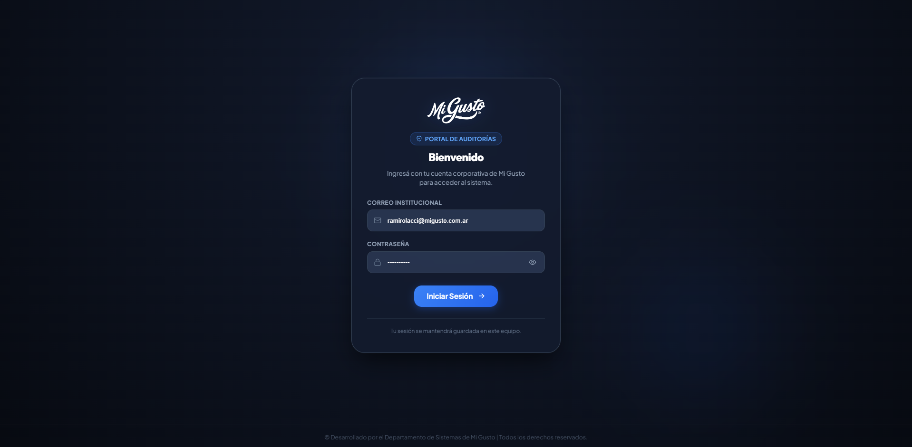
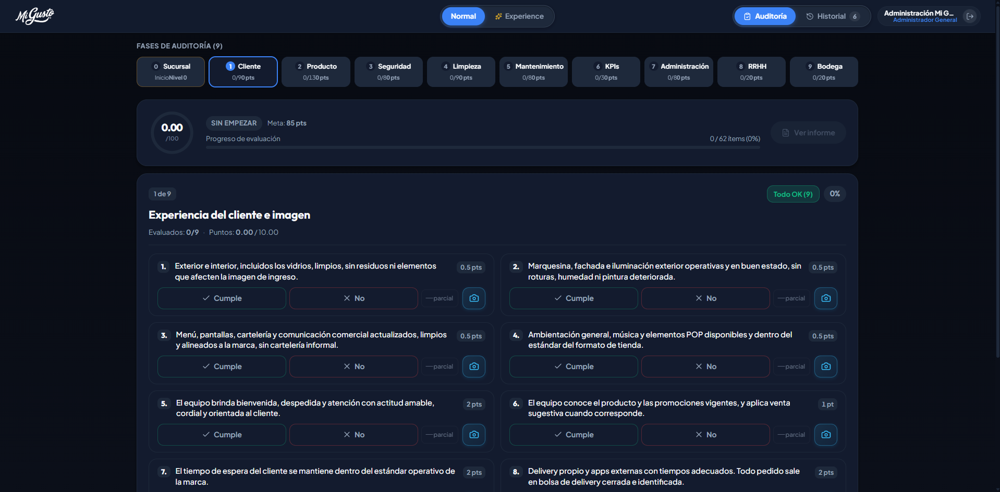
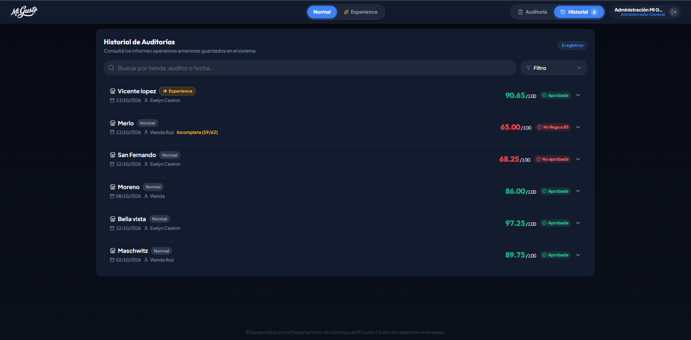
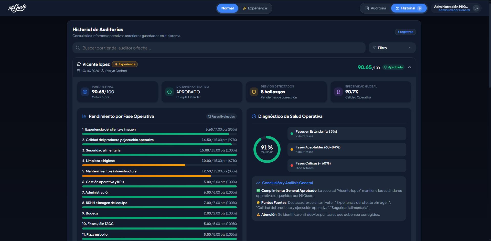

  

  # Portal de Auditorías Operativas

  

    <strong>Sistema integral de control de calidad, evaluación de estándares y diagnóstico de salud operativa para la red de locales Mi Gusto.</strong>
  

  

    
    
    
    
    
  

---

## 📸 Galería del Sistema

<table width="100%">
  <tr>
    <td width="50%" align="center">
      
       
      <b>🔐 Acceso Corporativo & Autenticación</b>
      
<i>Ingreso seguro con perfiles por rol y credenciales institucionales.</i>

    </td>
    <td width="50%" align="center">
      
       
      <b>📋 Evaluación Operativa en Tiempo Real</b>
      
<i>Navegación dinámica por fases, scoring en vivo y carga de evidencias.</i>

    </td>
  </tr>
  <tr>
    <td width="50%" align="center">
      
       
      <b>🗂️ Historial Centralizado & Filtros</b>
      
<i>Búsqueda instantánea por tienda, fecha o auditor con badges de estado.</i>

    </td>
    <td width="50%" align="center">
      
       
      <b>📊 Diagnóstico de Salud Operativa & KPIs</b>
      
<i>Desglose por fase, ponderaciones y reporte de hallazgos para planes de acción.</i>

    </td>
  </tr>
</table>

---

## ✨ Características Principales

### 🎯 Evaluación por Fases Estandarizadas
- **Segmentación Operativa Integral**: Cobertura estructurada de áreas clave (Atención al Cliente, Calidad del Producto, Seguridad e Higiene, Mantenimiento, KPIs, RRHH, Administración y Bodega).
- **Puntuación Ponderada en Vivo**: Cálculo dinámico del puntaje final sobre 100 puntos con metas automáticas de aprobación (meta estándar: 85 pts).
- **Doble Modalidad de Auditoría**: Soporte nativo para auditorías en modalidad **Normal** y modalidad **Experience**, adaptadas a las particularidades de cada tienda.

### 📸 Registro y Control de Desvíos
- **Gestión de Hallazgos**: Detección granular de desvíos con categorización inmediata (Cumple, No Cumple, Parcial).
- **Evidencia Visual**: Registro fotográfico integrado en cada ítem evaluado para respaldar las observaciones detectadas en sucursal.
- **Acciones Rápidas**: Marcado por bloques y navegación fluida entre fases sin fricción ni pérdida de datos.

### 📈 Diagnóstico de Salud Operativa
- **KPIs de Efectividad Global**: Métricas visuales de efectividad, porcentaje de calidad alcanzada y categorización de fases (En Estándar, Aceptables y Críticas).
- **Síntesis Ejecutiva Automatizada**: Diagnóstico analítico generado al instante, destacando fortalezas y puntos de atención prioritaria.
- **Reportes Listos para Exportar**: Generación de informes en formato digital (PDF / exportación estructurada) listos para auditorías gerenciales.

### 🔒 Seguridad y Persistencia Corporativa
- **Sincronización en la Nube**: Almacenamiento centralizado con Supabase para consulta distribuida y colaboración en tiempo real.
- **Resiliencia Offline**: Mecanismo de persistencia local preventiva para evitar pérdidas de progreso ante fluctuaciones de conectividad en planta.
- **Control de Roles**: Permisos diferenciados para auditoría, consulta y gestión de registros históricos.

---

## 🎨 Experiencia Visual & Diseño

La interfaz fue diseñada bajo un **Pure Dark Mode** de nivel industrial, concebido para brindar la máxima legibilidad y confort visual durante auditorías de campo:
- **Paleta Armónica**: Fondos Slate oscuros (`#0b0f19`, `#131b2e`), acentos azul eléctrico (`#3b82f6`) y contrastes funcionales según el dictamen operativo.
- **Micro-interacciones Fluidas**: Transiciones suaves impulsadas por **GSAP**, facilitando una navegación intuitiva y ágil entre paneles.
- **Diseño Responsive**: Interfaz totalmente adaptable a tablets, smartphones y terminales de escritorio.

---

  Desarrollado para el Departamento de Operaciones y Calidad de <strong>Mi Gusto</strong>.

